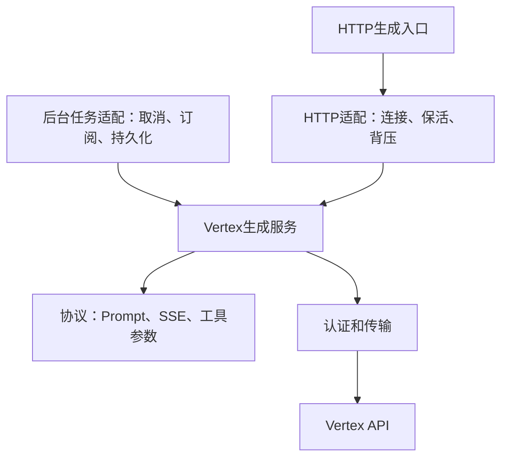

# Phase C：Vertex Native 与完整生成链路

状态：开发分支交付，等待独立审查。未合并release、未Tag/Release、未部署NAS。真实Google及NAS验收未完成。

## 本轮结果与边界

在官方运行代码上选择性接入Vertex Native，将协议、认证传输、生成生命周期与HTTP适配分开。后台调用直接消费同一生成服务，不制造Express请求/响应对象。流式与非流式共用转换、取消、续传和终态；签名随原始Part保存，工具调用保留供应商ID、参数、签名及顺序。

核心改动在 `stage/vertex-native-generation-contract`。柏宝库和柏宝箱需要独立兼容修改；本轮只在隔离副本实现和测试，作为配套补丁单独交付，没有把插件源码合入ST，也没有推送第三方仓库或更新安装。

因此，“完成组合验证”指**本分支 + 配套柏宝库补丁 + 配套柏宝箱补丁**的已测组合。不能解释为未修改的0.7.3/1.1.2已经兼容。当前NAS实际插件版本仍未取得证据；这不阻止代码独立审查，但正式组合验收必须使用实际版本。

不包含非Vertex性能改进、R2/R3/R4、诊断平台、完整DOM虚拟化或Docker发布流程。

## 来源与开发起点

| 对象 | 本轮起点/参考 |
| --- | --- |
| Personal Fork release | `06bde939fb1e9c4c8d8641d810f0a916b5bce127` |
| 官方release | 同为06bde939；与个人Fork同步 |
| 官方1.19.0 Tag | `7e8663cd9c184a550b37238218bdd32c6efc68e9`；到release仅npm工作流改变 |
| Shalistera release | `f67e000034a130dc25c7fb7571b5731f4c219f89`；相对当前基线31提交/110文件 |
| 选择性改编来源 | `510fbb545f3c713c869e86fff106b3d1a830ce63`的Vertex协议、传输思路、UI设置及必要Google/工具调用修改 |
| 柏宝库参考 | `b211a4e97fdaec24dc8b90c85ddc198fac9ac200`，0.7.3 |
| 柏宝箱组合参考 | `d14a2506fb0f8ca7aa3543df040b470a230e172c`，1.1.2；不是GitHub最新main或NAS安装断言 |

未cherry-pick整条参考分支。新增运行模块注释保留来源；没有引入Shalistera的诊断服务、其他缓存/渲染优化或额外运行依赖。package版本保持上游1.19.0，开发组合由分支/commit及插件补丁指纹识别，不冒充新正式版本。

前期审查的R1作为设计依据：问题包括伪HTTP对象契约、错误终态被过滤及恢复签名丢失，不能仅补on/flushHeaders。本轮还沿完整工具回合核对了重放后的函数名称映射、顺序和历史数组完整性。

## 架构与责任



| 边界 | 所有者/实现 | 职责 |
| --- | --- | --- |
| 协议 | `src/endpoints/backends/vertex-protocol.js` | 参数验证、Google Prompt、SSE完整事件、参数增量、工具ID/顺序；无HTTP响应和数据库 |
| 认证/连接 | `vertex-transport.js` | 每用户读取所选秘密、OAuth换取/刷新、目标地址和头、重定向策略；不记录上游错误正文 |
| 生成 | `vertex-native.js::runVertexGeneration` | 一次调用的deadline、上游流、续传、Part累积、usage及唯一最终结果；不保存聊天 |
| HTTP | `createVertexHandler` | Express事件、请求/响应关闭、保活、drain、SSE/JSON序列化和清理 |
| 后台任务 | 柏宝库独立补丁 | 自有AbortController、客户端断开后继续生成、状态/SQLite提交、结果恢复对象 |
| 聊天与显示 | ST及柏宝箱独立补丁 | ST原生生成/保存；恢复时插入完整消息，保留模型/签名/Swipe元数据及幂等边界 |

这是Vertex专用的轻量入口，没有抽象所有供应商，也没有复制原有OpenAI/Google后台转发逻辑。

### 内部契约v1

导出 `VERTEX_GENERATION_CONTRACT = 1`，调用：

```js
const result = await runVertexGeneration(
    { body, user, signal },
    { emit: async (frame, signal) => { /* 消费完整Google帧/进度；可等待背压 */ } },
);
```

`user`必须是服务端已认证上下文；`signal`由调用者拥有。`body`会被复制，HTTP和内部入口在同一服务中做Prompt后处理和schema转换。`emit`只接收完整帧及取消信号，不接收密钥。生成服务返回 `state/text/reasoning/signature/responseContent/usageMetadata/vertexMeta/error/candidate/metadata`，不会持久化，也不会把DONE当作业务成功。

HTTP断开会取消对应生成；后台任务的浏览器订阅断开只停止推送，任务继续。后台显式取消或插件退出才取消它拥有的调用。慢订阅者的输出缓存受到限制，可以断开后通过任务记录恢复。HTTP背压等待有独立30秒上限，避免终态发送被无限阻塞。

服务不自动重试HTTP/网络错误。Argon在API明确给出CONTINUATION及有效token时才请求下一段；内容和工具保持原请求，只增加continuationToken。最多32段，检测重复token，不将token发给浏览器或记入日志。MAX_TOKENS保留为部分完成，不伪装成STOP或自动重发原请求。

### 终态与持久化

| state | 含义 | 后台处理 |
| --- | --- | --- |
| completed | 收到正常完成标记和有效内容/完整工具调用 | 先提交结果记录，再公布完成 |
| partial | token上限，或已有内容后截断/失败 | 保留正文、思考、原始Parts和错误/警告；不标成完整成功 |
| failed | 无有效结果的错误，或结果持久化失败 | 明确错误；不自动重发；持久化失败不能宣称已保存 |
| canceled | 调用者取消 | 终止上游，保留已收到的部分内容与签名；不自动把取消结果插回聊天 |

SSE的error在正文之后仍然传递；终态在DONE之前，DONE仅代表传输结束。HTTP保活已经发头时，错误可能通过200响应中的结构化error表达，客户端必须检查内容。

柏宝库的completed表示任务结果已保存到其SQLite记录，不表示已经把助手消息写入聊天JSONL。正常页面由ST聊天保存链路写入；恢复由前端保存完整消息。部分结果恢复明确提示未完整完成。失败的持久化只能保留当前页面/内存中已有结果，不能保证重启后恢复，不做盲目重试。

取消在线性化的结算点之前胜出；进入一次持久化结算后，迟到的取消等待并观察同一终态。丢弃任务会取消且不在删除后重新建立记录。插件退出等待活动调用结算再关闭数据库。成功终态只在SQLite提交之后发布。

## Thought Signature和工具回合

同时保留ST的兼容字段 `reasoning_signature` 和 `extra.vertex_response` 中的原始Parts，另有 `vertex_generation` 终态。签名Part不与普通Part合并，也不与另一个签名拼接。工具ID沿用供应商值；参数流完整后才交给ST工具执行，多个调用保持起始顺序，重复已完成ID明确失败，未完成参数/异常终态不自动执行工具。

完整工具回合从模型调用、前端工具动作、存储的invocations到下一次FunctionResponse，都保留id/name/顺序/签名。原生Parts重放会同步建立工具名称映射。带有相同原生响应ID的中间显示消息不会在Prompt中再复制一遍，历史保持稠密。Prompt合并保留原生记录边界；姓名前缀等新增文本使用独立未签名Part。

复用要求供应商、模型及对应消息/工具参数匹配。编辑消息、改变生成后文本语义、换模型或不匹配的群组成员时不重放旧记录。已接收签名仍保存在记录中，不强行把它附到改写过的正文上。无签名的新Swipe也不会继承旧签名。

`actual_content`是独立的特殊正文封装：只有单一该工具、显式启用选项时展开。原始函数Part及签名另存为envelope，**不把函数签名移动成普通文本签名**；下一轮按展开后的正文语义处理，不宣称它等于普通Function Calling回合。普通或混合工具不会被自动展开。柏宝库原有OpenAI `emit_complete_response`约定维持原路径，未推广为Vertex通用协议。

## 认证、网络与资源边界

- 支持Express API Key、项目级Key配置、服务账号JSON及显式反向代理认证。秘密按用户目录和secret_id读取；OAuth缓存键包括用户root和完整秘密的SHA-256，容量上限100，过期/401可失效。一次调用取消不会取消其他调用的刷新。
- Express无项目时使用global；项目/服务账号按region构造固定Google端点。global、us、eu及普通区域按模型能力使用；Argon限制global/us/eu。现有Express配置若仍为us-central1且未填项目，会明确提示调整，不静默改写用户设置。
- 反向代理origin需列入服务端 `vertexai.allowedReverseProxyOrigins`，默认空；URL不得含内嵌凭据、query或fragment。代理只使用专用proxy_password，不转发所存Google密钥。
- 模型请求及OAuth禁止自动重定向。反向代理沿用ST的连接时私网过滤与IP固定机制，显式私网需管理员现有白名单；没有“先验证DNS再重新解析连接”的新路径。
- 若管理员使用ST outbound request proxy，其代理继续拥有路由和远端DNS；本实现不能在ST进程内证明代理远端的DNS/内网策略，必须在实际代理链验收。origin允许列表仍有效，不绕过既有网络安全配置。
- 不记录Prompt、秘密、服务账号断言、上游错误正文或续传token。上游异常只输出受控状态/错误类别。Vertex后台持久化副本剔除proxy_password；结果和Prompt按原有每用户存储职责保护。
- 限制：单SSE事件32MiB，整次响应64MiB，函数参数流4MiB，Parts最多100000、完整工具调用约1024，参数路径深度64，输出token至多1048576，本地deadline30–7200秒。触限显式错误，不静默截短。

## 能力支持与证据矩阵

“隔离通过”包含受控本地供应商或浏览器输入，不代表Google接受该账号/模型的所有参数。整个真实Google列仍待验收。

| 能力 | 原生Vertex | Vertex + 配套Save Generate | 当前证据/限制 |
| --- | --- | --- | --- |
| 普通文本、多轮上下文 | 已实现，隔离通过 | 普通/再生文本已实现，隔离通过 | 真实模型待验 |
| 流式/非流式 | 已实现，隔离通过 | 两种均隔离通过 | 保活、终态、单次请求已测 |
| Thinking/Reasoning | 已实现，隔离通过 | 保存/恢复文本和签名通过 | 实际模型thinkingLevel/预算待验 |
| Continue | 已实现，协议和浏览器通过 | 不接管，派发前走原生 | 不支持预填的模型使用明确续写user指令；旧模型预填能力保留 |
| Regenerate | 完整Generate流程通过 | 支持normal/regenerate范围 | 不额外发请求；元数据随替换更新 |
| Swipe | 保存/错误/元数据浏览器通过 | 不接管，走原生 | 多候选n>1明确不支持；不是禁止单独Swipe |
| 普通函数工具、多工具、多轮工具 | 协议、HTTP两回合、浏览器实际工具动作和完整Generate循环通过 | v1不接管普通工具，派发前走原生；直接调后台接口会拒绝 | 保留ST工具动作；不在后台复制工具执行器 |
| 特殊actual_content | 显式启用后已实现，隔离通过 | 配套补丁支持该限定封装，隔离通过 | 原始envelope保留；不是普通工具回合 |
| JSON/结构化输出 | 转换和schema测试通过 | 复用同一转换 | Google schema子集和真实结果仍待验 |
| 图片输入 | 已实现，转换测试通过；Argon UI可达 | 文本结果范围使用同一请求 | 实际图片/模型待验 |
| 支持模型的图片输出 | 已实现，协议及浏览器帧测试通过 | 不接管，派发前走原生；后台接口拒绝 | Argon文本模型不支持输出图片；完整多轮图片编辑签名仍待专门验收 |
| 音视频输入 | 沿用ST数据URL转换，Argon入口可达 | 依实际文本生成范围 | 已实现但未做真实媒体测试；无新音频/视频输出能力 |
| Google Search/URL Context/代码执行/其他允许的原生工具 | 后端参数支持；Search已有UI | 不承诺后台恢复原生工具产物 | 参数转换已有覆盖，真实供应商和完整原生产物展示待验；没有新增通用工具UI |
| 停止生成 | HTTP断开和显式信号通过 | 取消API、退出等待通过 | 取消结果不冒充完成 |
| 网络中断/限流/超时/认证失败 | 受控测试通过 | 错误、部分结果和持久化行为通过 | 真实Google认证/配额/代理仍待验 |
| 模型/连接切换 | 供应商/模型隔离及请求快照测试通过 | 需配套恢复元数据 | 不重用不匹配的原生记录；多设备NAS待验 |
| Argon官方长输出分段 | CONTINUATION自动接续和保护已实现、合成测试通过 | 共用服务 | v1beta1；真实长输出和计费/usage语义待验 |
| 上游HTTP/网络自动重试 | 未实现 | 未实现 | 避免重复模型请求；用户明确重试是另一次生成 |

Argon的temperature/top-p/top-k由模型忽略，会在元数据/UI说明；不悄悄把它们当成有效控制。Argon不支持的非零frequency/presence penalty、seed控制、候选数等明确拒绝。MAX_TOKENS保持部分完成。Flex在当前Google文档中不支持Argon，选该组合会拒绝。模型清单与后端模型ID验证分开，不将手写支持表当成Google动态能力目录。

## 插件独立兼容范围

配套补丁不在ST仓库内，随外部审查包提供。两个上游仓库未被修改。补丁只针对表中固定参考commit，尤其柏宝箱不是最新main；对其他安装版应重新比较后适配，不能直接覆盖。

| 项目 | 独立修改范围 | 理由 |
| --- | --- | --- |
| 柏宝库 `save-generate.js` | Vertex调用专用服务；取消/退出、订阅、唯一终态、提交后发布；完整恢复对象；不再重复缓存整个SSE正文 | HTTP对象不属于后台生成的业务契约；必须保留后台持久化能力 |
| 柏宝库 `api.js` | 仅在ST实际导出v1契约时声明Native能力 | 防止旧ST被误认为可内部调用 |
| 柏宝库 `st-endpoints.js / plugin.js` | 等待活动Vertex任务关闭后再清缓存/数据库 | 避免服务退出时任务重新开DB或丢结算 |
| 柏宝箱 `saveGenerate.js` | 派发前能力协商；限定接管范围；识别partial；恢复完整ST消息并保存元数据 | `/sendas`会变成manual消息并执行宏/正则，不能用于保真模型恢复 |
| 柏宝箱 `dist/index.js` | 对应源改动的隔离生产构建 | 安装入口实际加载dist；只有src补丁不能算可运行交付 |

前端恢复先绑定目标聊天/角色，完整消息一次插入；保存失败保持可重试，切聊天后不渲染到新上下文，重复恢复不重复插入。只在派发前做原生回退；模型请求已经派发后不根据错误盲目重发。未适配的柏宝库通过旧伪HTTP路径调用本分支Vertex会得到明确契约错误，不在ST里补齐其伪对象。

## 本轮验证

| 检查 | 结果 | 能证明的范围 |
| --- | --- | --- |
| ST ESLint | 通过 | 生产源码与前端规则 |
| ST既有Jest | 19 suites / 411 tests通过 | 原有回归；不等于所有供应商线上验证 |
| `npm run test:vertex` | 53通过，0跳过 | 25协议/服务/传输及HTTP适配，23真实HTTP/SQLite组合，5实际插件函数恢复/能力测试 |
| 新增Chromium专项 | 12通过 | 实际浏览器模块、工具动作、完整Generate/Regenerate/工具循环、停止/错误、Continue/Swipe与元数据 |
| 柏宝库原有Save Generate测试 | 19通过 | 非Vertex既有封装/持久化链路回归 |
| 柏宝箱生产构建/修改文件ESLint | 通过 | dist生成、实际相对导入路径和代码规则；不是插件全UI验收 |

环境：Linux、Node24.22.1、Chromium153.0.8010.0、Playwright1.65.0。只使用临时用户/聊天/SQLite、本地模拟供应商和浏览器请求。没有真实Google凭据、账单调用、NAS或正式数据。

HTTP测试使用真实Express路由和真实插件模块/SQLite，不是给原来的伪对象补两个mock方法。浏览器加载实际ST模块，只在测试页面暴露私有StreamingProcessor以覆盖收尾；控制供应商响应并隔离第三方扩展自动初始化。

可复跑：

```bash
npm run lint
npm run test:vertex
cd tests
npm run test:unit -- --runInBand
ST_BASE_URL=http://127.0.0.1:8000 npx playwright test frontend/VertexNative.e2e.js
```

最后一项只指向另行建立的隔离ST实例，不能拿正式NAS运行数据做测试。PR检查已加入`test:vertex`；本轮未创建PR，不宣称已经运行GitHub CI。`test:vertex`在没有配套插件副本时会明确跳过对应组合项，不能把跳过算作组合通过。完整组合需先在隔离目录准备固定插件及审查包补丁。Node20及better-sqlite3实际驱动未在本轮运行，生产运行时需实机确认。

## 已知限制及后续验收

1. 本轮没有验证真实Express Key/项目Key/服务账号、Google配额、真实模型、区域和代理链。OAuth交换/隔离/失效是受控测试，不能替代真实认证验收。
2. 后台v1仍仅normal/regenerate文本回复，普通工具、Swipe、Continue、图片输出由原生路径处理。没有为一个Provider扩展后台工具执行器。
3. `actual_content`展开不等于普通Function Calling，原始函数签名保存在envelope中，不重放为文本签名。Google原生产物和完整多轮图片编辑需要额外真实模型验收。
4. 真实长输出、CONTINUATION的分段usage/费用、移动端SSE及代理缓冲还未验证。没有按合成结果承诺NAS延迟或吞吐。
5. 结果提交失败不能保证重启恢复；认证/传输不自动重试。活动任务进程崩溃的完整实时checkpoint不在当前插件v1职责中，本轮未新增灾难恢复框架。
6. 两个插件的独立更新机制可能覆盖本地适配。审查后需选择可追溯的插件维护方式并记录组合版本，不能只固定ST镜像。
7. 当前未发现该已测组合中的P1阻断；未适配插件、未完成真实模型/NAS验收的组合仍不能作为可部署结论。

下一步先独立审查ST边界、配套插件补丁、支持矩阵和测试证据；随后在隔离实例使用真实Google认证，执行：文本SSE/JSON各一轮、Thinking、多轮工具、停止、断流、长输出、模型切换、图片、后台关闭页面/恢复、取消/部分结果/重启恢复、原有OpenAI与AI Studio对照。比较正文、思考、工具id/name/顺序、签名、终态、上游调用次数和保存次数。

通过独立审查后再决定下一开发/验收阶段。R2/R3/R4及非Vertex性能优化继续后置，本轮不进入合并、发布或正式部署。

## 官方资料

本轮按2026-11-08读取的官方资料核对；模型能力未来变化时应重新确认。

- [Argon开发指南：长输出、thinking、参数与历史约束](https://docs.cloud.google.com/gemini-enterprise-agent-platform/models/guides/gemini-4-argon)
- [Thought signatures：原始Part与工具回合](https://docs.cloud.google.com/gemini-enterprise-agent-platform/models/thinking/thought-signatures)
- [Function calling：partialArgs与多函数](https://docs.cloud.google.com/gemini-enterprise-agent-platform/models/tools/function-calling)
- [Express mode端点与认证](https://docs.cloud.google.com/gemini-enterprise-agent-platform/models/start/express-mode/overview)
- [Flex PayGo支持边界](https://docs.cloud.google.com/gemini-enterprise-agent-platform/models/flex-paygo)
